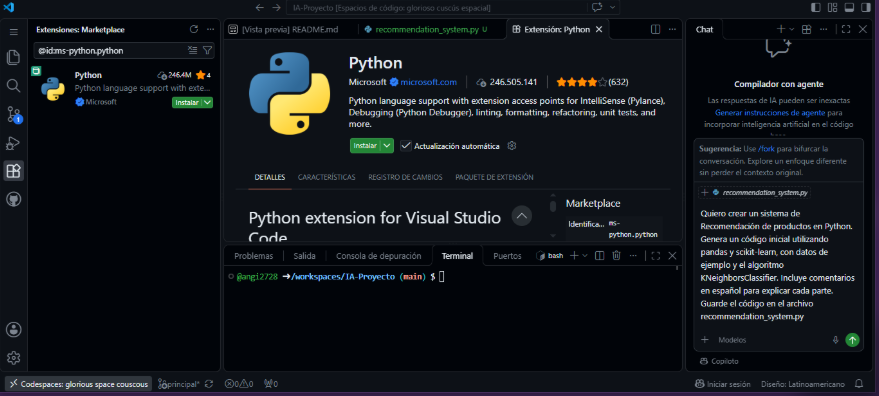
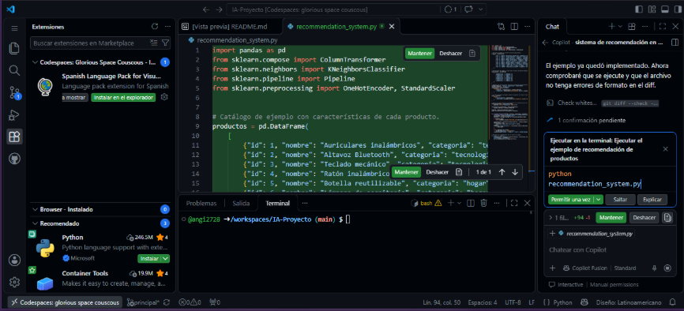
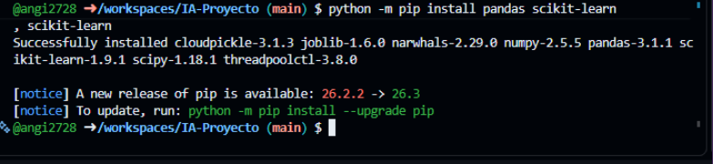
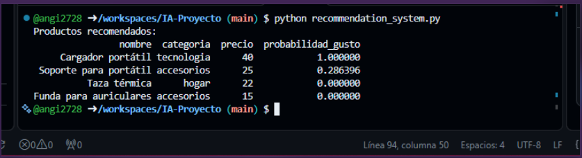
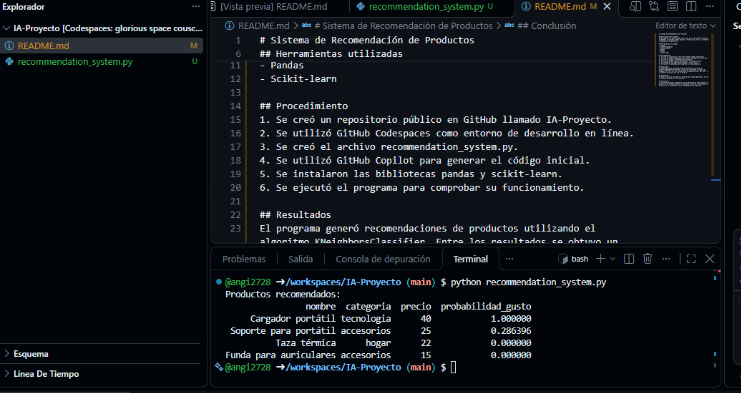
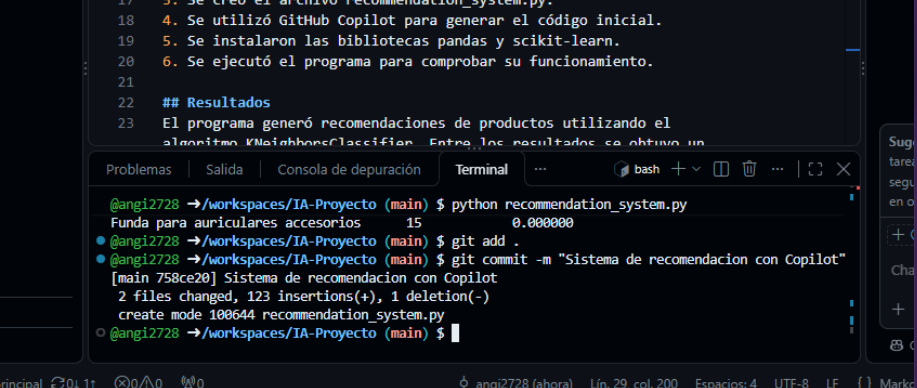

# Sistema de Recomendación de Productos

## Descripción del proyecto
Este proyecto fue desarrollado como parte de una actividad formativa de INACAP, utilizando GitHub Copilot y Python para crear un sistema de recomendación de productos.

## Herramientas utilizadas
- GitHub
- GitHub Codespaces
- GitHub Copilot
- Python
- Pandas
- Scikit-learn

## Procedimiento
1. Se creó un repositorio público en GitHub llamado IA-Proyecto.
2. Se utilizó GitHub Codespaces como entorno de desarrollo en línea.
3. Se creó el archivo recommendation_system.py.
4. Se utilizó GitHub Copilot para generar el código inicial.
5. Se instalaron las bibliotecas pandas y scikit-learn.
6. Se ejecutó el programa para comprobar su funcionamiento.

## Resultados
El programa generó recomendaciones de productos utilizando el algoritmo KNeighborsClassifier. Entre los resultados se obtuvo un cargador portátil con una probabilidad estimada de gusto del 100 % y un soporte para portátil con un 28,64 %.

## Evidencias del procedimiento

A continuación, se presentan las capturas que documentan las principales etapas del desarrollo del proyecto.

### 1. Creación del repositorio en GitHub

### 2. Apertura del repositorio en GitHub Codespaces

### 3. Solicitud de generación de código mediante GitHub Copilot

### 4. Generación del código del sistema de recomendación

### 5. Instalación de bibliotecas

### 6. Ejecución y comprobación del programa

### 7. Documentación del proyecto en README.md

### 8. Registro y guardado de cambios mediante Git

[Ver todas las capturas en la carpeta de evidencias](capturas/)

## Conclusión
La actividad permitió comprender cómo GitHub Copilot puede apoyar el desarrollo de código mediante inteligencia artificial, facilitando la creación de un sistema básico de recomendación de productos.
